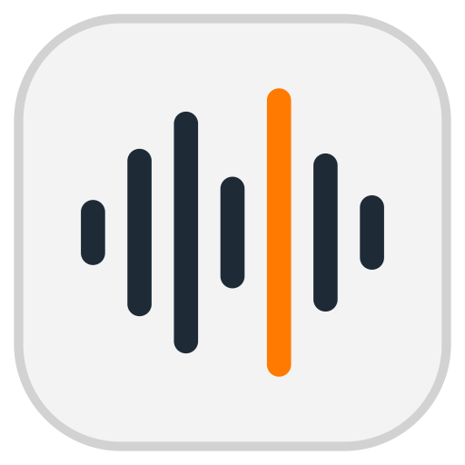
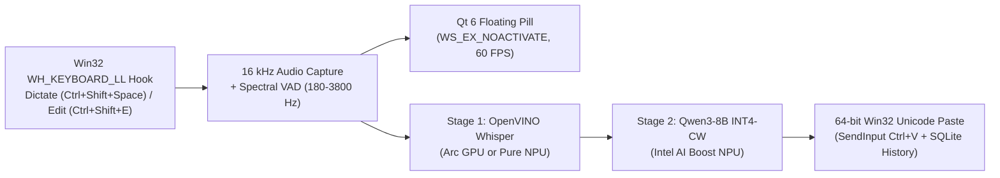

<p align="left">
  
</p>

# Ceres — Local Intel AI Boost NPU Voice Dictation & Editing Suite

[](https://github.com/jbuscher-bds/Ceres/actions/workflows/ci.yml)
[](https://www.python.org/)
[](https://docs.openvino.ai/)
[](https://doc.qt.io/qtforpython-6/)
[](LICENSE)

**Ceres** is a 100% offline, privacy-first Windows voice dictation, sentence-polishing, and voice-editing desktop application accelerated by **Intel AI Boost NPU** and **Intel Arc iGPU** via OpenVINO GenAI.

Speak naturally anywhere in Windows — in **English, Dutch (*Nederlands*), or German (*Deutsch*)** — and Ceres removes hesitation fillers (*"um"*, *"uh"*, *"eh"*, *"euh"*, *"zeg maar"*, *"äh"*, *"ähm"*), resolves mid-sentence self-corrections, restructures rough speech into fluent prose, and pastes the result directly at your cursor without sending a single byte to the cloud.

<!-- Add your demo recording at docs/demo.gif and uncomment:

-->

---

## Key Features

- **Dual-Stage Local Edge AI**:
  - **Speech-to-Text**: `OpenVINO/whisper-large-v3-turbo-int8-ov` on Intel Arc iGPU (0.23 s transcription for ~7 s speech, 0.75 s cached startup) + optional `OpenVINO/whisper-base-int8-ov` pure-NPU mode.
  - **Sentence Rewriter & Voice Editor**: `OpenVINO/Qwen3-8B-int4-cw-ov` compiled directly on **Intel AI Boost NPU** (5.88 s cached startup, non-thinking mode enabled).
- **Smart Hybrid Global Shortcuts**:
  - **Dictate (`Ctrl + Shift + Space`)**: Quick tap (`< 0.35 s`) toggles hands-free recording; hold (`>= 0.35 s`) works as Push-to-Talk; **`Esc`** cancels cleanly.
  - **Voice Edit Mode (`Ctrl + Shift + E`)**: Highlight existing text in any app, press the edit shortcut, speak a command (*"Make this more polite"*, *"Summarize in 3 bullets"*, *"Translate to Dutch"*), and Ceres replaces the selection in place.
- **Custom Vocabulary**:
  - Supports user-defined domain terms, names, and acronyms so technical spellings are preserved accurately.
- **Native Qt 6 HiDPI UI & Non-Activating Pill**:
  - 60 FPS translucent `QPainter` pill overlay styled with Win32 `WS_EX_NOACTIVATE` so keyboard focus stays in your editor/browser, automatically placed on the active monitor and draggable across displays.
- **Speech-Band Spectral VAD**:
  - Combines adaptive RMS gating with `180–3800 Hz` FFT voice-band ratio checks to reject laptop fan rumble, mains hum, and short desk clicks.
- **History Search, Markdown Export & Re-polish**:
  - Local SQLite persistence (`data/history.db`), live search, Markdown export, and one-click re-polishing between `Fluent` and `Light` modes.

---

## Architecture



---

## Engineering Decisions & Trade-offs

| Challenge | Engineering Solution | Why It Matters |
| :--- | :--- | :--- |
| **Whisper NPU `ZE_RESULT_ERROR_DEVICE_LOST`** | Isolated one-time subprocess probe (`whisper_npu_probe.json`) + loading `LLMPipeline` before `WhisperPipeline` | Prevents an incompatible Whisper graph from poisoning the Level Zero NPU context needed by `Qwen3-8B`; defaults to hybrid `Arc GPU` (Whisper) + `AI Boost NPU` (LLM) with `whisper-base` pure-NPU option. |
| **Small INT4-CW LLMs garbling Dutch & German** | Switched from `Phi-3.5-mini` to `OpenVINO/Qwen3-8B-int4-cw-ov` with `enable_thinking=False` (`<think>\n\n</think>\n\n`) and `<transcript>`/`<output>` sandboxing | Eliminates cross-language translation drift, chatbot answers to spoken questions, and inverted self-corrections while running inside the NPU's `MAX_PROMPT_LEN=2048` budget. |
| **HiDPI scaling & CustomTkinter CPU lag** | Migrated UI from CustomTkinter + pystray to native **PySide6 (Qt 6)** and decoupled 30 Hz audio RMS levels from main window / tray state updates | Fixes tiny pixel-sized overlays on 14" HiDPI displays, eliminates 30 Hz `Shell_NotifyIcon` / canvas redraw lag, and supports multi-monitor positioning via `MONITORINFOEXW.szDevice`. |
| **64-bit Windows `ctypes` pointer truncation** | Explicit `c_void_p`, `c_ssize_t`, `WPARAM`, `LPARAM`, and full `INPUT` union prototypes on `user32` / `kernel32` | Prevents `OverflowError` and `HGLOBAL` pointer crashes on 64-bit Python 3.12–3.14 when hooking keyboard events, reading/writing UTF-16LE clipboard text, or sending `Ctrl+C` / `Ctrl+V`. |
| **ISP IPv6 TLS resets on Hugging Face Hub** | Scoped `_prefer_ipv4()` resolver + retry with `HF_HUB_DISABLE_XET=1` fallback in `model_manager.py` | Prevents `[WinError 10054]` handshake resets during initial model download on networks with broken IPv6 routes to CloudFront. |

---

## Verified Benchmarks & Multilingual Examples

Measured locally on **Intel Core Ultra 7 258V** (32 GB LPDDR5x, **Intel AI Boost NPU** + **Intel Arc 140V GPU**):

- **Cached Startup**: `Qwen3-8B-int4-cw-ov` on NPU `5.88 s` · `whisper-large-v3-turbo-int8-ov` on GPU `0.75 s`
- **End-to-End 6.92 s Audio**: Whisper (`234 ms`) + Qwen3-8B NPU (`2,423 ms`)

| Language | Mode | Spoken Input (Raw) | Ceres Output (NPU `Qwen3-8B-int4-cw-ov`) | Latency |
| :--- | :--- | :--- | :--- | :--- |
| **English** | `Fluent` | *"Um so I was thinking like maybe we should uh push the release to Monday, wait no Tuesday morning, because yeah Friday is totally packed."* | *"We should push the release to Tuesday morning, since Friday is totally packed."* | 3,435 ms |
| **English** | `Question` | *"Uh can you tell me if the client already signed the contract?"* | *"Can you tell me if the client already signed the contract?"* | 3,603 ms |
| **Dutch** | `Fluent` | *"Eh ik wilde zeg maar vragen of we de vergadering om drie uur, nee wacht om vier uur kunnen inplannen, want dan is iedereen erbij."* | *"Kunnen we de vergadering om vier uur inplannen, want dan is iedereen erbij?"* | 4,715 ms |
| **Dutch** | `Light` | *"Euh stuur mij straks nog even het nieuwe document door alsjeblieft."* | *"Stuur mij straks nog even het nieuwe document door alsjeblieft."* | 4,270 ms |
| **German** | `Fluent` | *"Ähm ich wollte nur kurz Bescheid sagen, dass wir halt morgen leider erst um neun, nein warte um zehn Uhr im Büro sind."* | *"Ich wollte nur kurz Bescheid sagen, dass wir morgen leider erst um zehn Uhr im Büro sind."* | 4,566 ms |
| **German** | `Question` | *"Äh kannst du mir bitte sagen, wann der Bericht fertig ist?"* | *"Kannst du mir bitte sagen, wann der Bericht fertig ist?"* | 3,902 ms |

---

## Quick Start

### Prerequisites
- Windows 10/11 (64-bit) with Python 3.12–3.14
- Intel Core Ultra processor with **Intel AI Boost NPU** (or Intel Arc GPU / x64 CPU fallback)

### Installation
```powershell
git clone https://github.com/jbuscher-bds/Ceres.git
cd Ceres
powershell -ExecutionPolicy Bypass -File .\setup.ps1
```

### Launch
- **Background Tray Launch (no console)**: Double-click `launch_ceres.vbs` (or enable **Start Ceres minimized with Windows** inside Settings).
- **Console Launch**: Run `.\run_ceres.bat` (or pass `--minimized`).

> **Note on Models**: Model weights are downloaded automatically from Hugging Face on first run into `models/` (excluded from Git). Default setup uses ~5.3 GB (`whisper-large-v3-turbo-int8-ov` + `Qwen3-8B-int4-cw-ov`).

---

## Development, Testing & Packaging

```powershell
# Lint & type check
.\.venv\Scripts\ruff.exe check src tests scripts
.\.venv\Scripts\mypy.exe src

# Automated unit tests
.\.venv\Scripts\pytest.exe -v

# Qt 6 HiDPI pill & Win32 global hook smoke test
.\.venv\Scripts\python.exe -m ceres --self-test

# Live hardware NPU/GPU end-to-end check (requires downloaded models)
.\.venv\Scripts\python.exe scripts\verify_npu_pipeline.py
```

To bundle a standalone Windows directory distribution using PyInstaller:
```powershell
.\.venv\Scripts\pip.exe install pyinstaller
.\.venv\Scripts\pyinstaller.exe packaging\ceres.spec
```

---

## License

Licensed under the [MIT License](LICENSE) — Copyright (c) 2026 Johannes Buscher.
